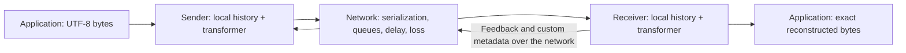

# Trace Transport

**A self-play testbed for history-based learned network protocols.**

[GitHub repository](https://github.com/cpaxton/trace-transport)

Trace Transport trains small transformers to exchange arbitrary text exactly
over networks with unknown capacity, packet loss, changing latency, and competing
traffic. Both endpoints run our software. We can design the packet format,
feedback, metadata, and control rules together; TCP wire compatibility is not a
requirement.

**Status:** working CPU reference implementation. Exact UTF-8 transfer, a seeded
multi-flow packet simulator, fixed-rate/AIMD controllers, a masked history
transformer, PPO training, paired evaluation, and single-message UDP adapters are
implemented, including MLP/GRU history baselines and versioned reward profiles.
The learned policy currently controls the sender; receiver feedback
and custom metadata are deterministic. Joint sender/receiver learning and a
GPU-native simulator remain planned. The [paper working draft](paper/main.tex)
describes the system and evaluation plan; preliminary diagnostics do not establish
general superiority over transport baselines.

## Run it

Python 3.10 or newer is required. The simulator needs NumPy; PyTorch is optional
unless training or using a transformer checkpoint.

```bash
python3 -m venv .venv
source .venv/bin/activate
python -m pip install -e ".[dev]"

# Send arbitrary inline text and save the exact UTF-8 bytes.
trace-transport simulate --text 'Hello, こんにちは 🌐' \
  --loss 0.1 --ack-loss 0.1 --seed 7 --show-text --output received.txt

# Competing senders, an outage, and changing capacity.
trace-transport simulate --text 'Competing traffic' --flows 4 \
  --outage 0.1 0.4 --capacity-change 0.5 2.0 --report runs/scenario.json

# For meaningful congestion behavior, supply a larger UTF-8 file of your own.
trace-transport evaluate --input message.txt --flows 4 --seeds 5 \
  --controllers fixed aimd --report runs/baselines.json

pytest -q
```

### Ten-trial benchmark and RL score

```bash
# Ten paired trials for fixed-rate and AIMD: two 32 KiB transfers per trial.
trace-transport benchmark

# Include a trained checkpoint, with the same workload and seeds for every controller.
trace-transport benchmark --controllers fixed aimd transformer \
  --checkpoint checkpoints/smoke.pt --trials 10 --seed 100

# More severe impairments or your own exact UTF-8 input.
trace-transport benchmark --input message.txt --loss 0.1 --ack-loss 0.1 \
  --corruption 0.02 --ack-corruption 0.02 --flows 4 --trials 10
```

`benchmark` is an alias for `evaluate`. Both now default to ten seeds, a readable
summary table, and a detailed JSON report at `runs/benchmark.json`. Use
`--format json` for JSON on stdout and `--report PATH` for another destination.
With no `--text` or `--input`, the workload is exactly 32,768 bytes of valid UTF-8;
`--message-bytes` changes its size. Explicitly supplied text, including an empty
string, is preserved. Ten trials per controller with two flows means twenty
transfer attempts per controller, not ten independent samples per flow.

Default benchmarks apply 2% random data/ACK loss and 1% data/ACK bit corruption,
plus finite-queue drops. `simulate` keeps corruption disabled by default; both
commands accept `--corruption` and `--ack-corruption`. A corrupted packet has an
actual flipped wire bit and is rejected by the existing CRC check. The policy
observes missing feedback and eventual timeouts, not a simulator corruption flag.

The report separates:

- **Completion %:** exact reconstructed bytes with sender confirmation before the deadline.
- **Exact RX %:** exact receiver reconstruction, even if final feedback never reached the sender.
- **Drops:** random, queue-overflow, and outage losses across both directions, divided by attempted packets.
- **Corruption:** packets with injected bit flips and packets actually rejected by CRC. Injected packets can still be in flight or encounter an outage at the deadline.
- **Wrong payloads:** reconstructed messages that differ from the source. Missing messages are incomplete, not silently counted as correct.
- **Retry %:** retransmitted application bytes divided by all application bytes transmitted.
- **Latency/goodput:** successful completion-time percentiles, pooled sampled RTT percentiles, and mean network goodput over trials. Completion latency excludes failures; completion rate and RL score retain them.
- **RL score:** the mean discounted sum of actual `TransportEnv.step()` rewards per transfer, including unfinished transfers. The common selected profile declares the reward and gamma (0.99 for legacy, 0.999 for completion). JSON also records the undiscounted return and both scores for each transfer.

Completion percentage is a key quality metric, but it is not the whole RL
objective: two policies can both complete 100% while having different queueing
delay and wire overhead. Compare returns with identical message sizes, seeds,
network settings, deadlines, and reward definitions; a larger message earns more
progress reward. The JSON stores each trial's configuration, per-flow return,
integrity status, packet counters, and checkpoint SHA-256. These quick batches
support debugging; broader held-out evaluation is needed for performance claims.

`--input` and `--output` preserve exact file bytes, including CRLF and trailing
newlines. Inputs must be valid UTF-8. The current implementation accepts messages
up to 16 MiB and buffers a complete message; streaming larger messages is future
work. `simulate` and `send` exit with status 2 on an incomplete transfer and do
not write a partial output as a successful message. `evaluate` records timeouts
as outcomes and exits normally. Rates use bits/s in network settings and bytes/s
inside the sender. Run any subcommand with `--help` for options.

### Train and use the transformer

The repository includes the selected CPU-loadable checkpoint at
`artifacts/robust-v2-best.pt`, its SHA-256, and a compact diagnostic report at
`artifacts/robust-v2-results.json`. After installing the `learn` extra, try it
without training:

```bash
trace-transport benchmark --controllers fixed aimd learned --reward completion \
  --checkpoint artifacts/robust-v2-best.pt
```

```bash
python -m pip install -e ".[learn]"

# A software smoke run, not a claim of a good congestion controller.
trace-transport train --updates 5 --envs 4 --flows 2 --rollout-steps 32 \
  --epochs 2 --history 16 --output checkpoints/smoke.pt

trace-transport simulate --text 'A learned sender 🌐' \
  --controller transformer --checkpoint checkpoints/smoke.pt --show-text

trace-transport evaluate --input message.txt --flows 4 --seeds 5 \
  --controllers fixed aimd transformer --checkpoint checkpoints/smoke.pt \
  --report runs/learned-comparison.json
```

Training randomizes capacity, RTT, jitter, random loss, queue size, and message
size for each episode. It uses a shared sender policy across independent CPU
networks and produces a schema-checked checkpoint plus JSONL metrics.
`--actions 2` enables window control as well as pacing. `--device cuda` moves the
model and PPO updates to a usable CUDA device; it does **not** move this CPU
simulator to the GPU. Start with the CPU for these small runs. A useful trained
controller requires longer training and held-out evaluation.

### Robust training and history baselines

`--profile legacy` preserves the original fixed-flow, 0--5% loss experiment.
`--profile robust` samples clean, lossy, changing, and stress episodes with one
through `--flows` senders, up to 15% random loss, up to 2% corruption, randomized
feedback capacity, smaller queues, outages, and capacity changes. The sampler is
independent of the frozen evaluation manifests. Inactive batch slots are masked
out of PPO rather than treated as synthetic agents.

`--reward legacy` retains `transport-v1` and gamma=0.99. `--reward completion`
selects `transport-v2` and gamma=0.999. At 20 ms per step these have roughly
2-second and 20-second horizons: a completion bonus after 20 seconds retains
about 0.0043% or 37% of its original weight, respectively.

The v2 per-transfer reward is:

```text
newly_ACKed_unique_bytes / max(message_bytes, 1)
+ 2 * just_completed - 2 * timed_out
- 0.05 * elapsed_active_seconds
- 0.01 * (RTT_inflation / 0.1 seconds) * elapsed_active_seconds
- 0.1 * overhead_wire_bytes / max(message_bytes, 512)
```

This adds a cost for waiting, normalizes progress by message size, and strengthens
completion and failure signals. Correctness remains enforced by protocol code.
Reports declare the full scoring specification and reject mixed reward profiles.
Old defaults remain available for reproducibility: explicitly pass
`--profile robust --reward completion` for new training and `--reward completion`
for a comparison in which every controller receives the same v2 score.

Three policies consume the same masked history window. The MLP flattens it; the
GRU processes its valid suffix, recomputing state from that window on every call.
These settings approximately match parameter counts, not computational cost:

| Model | History | Width | Layers | Parameters |
| --- | ---: | ---: | ---: | ---: |
| Transformer | 16 | 64 | 2 | 102,723 |
| MLP | 16 | 152 | 3 | 103,211 |
| GRU | 16 | 104 | 2 | 105,875 |

```bash
# Substitute architecture, width, and layers from the table for each baseline.
trace-transport train --architecture transformer --width 64 --layers 2 \
  --history 16 --profile robust --reward completion --flows 4 --envs 8 \
  --min-message-bytes 16384 --max-message-bytes 98304 --episode-seconds 20 \
  --updates 400 --rollout-steps 64 --epochs 2 --seed 42 \
  --output checkpoints/robust-v2-transformer-s42.pt

# Checkpoint metadata selects transformer/MLP/GRU automatically.
trace-transport simulate --controller learned \
  --checkpoint checkpoints/robust-v2-transformer-s42.pt \
  --reward completion --text 'A learned protocol 🌐'

trace-transport suite --reward completion --trials 10 --seed 1000 \
  --policy candidate=checkpoints/robust-v2-transformer-s42.pt
```

The robust-v2 experiment uses training seeds 42 and 43 per architecture, plus a
robust transformer with the legacy reward as an ablation. Validation uses seeds
1000--1009; final evaluation reserves seeds 2000--2019. Selection first maximizes
completed validation transfers, then mean per-scenario v2 score. The plan is
recorded in the [declared experiment plan](experiments/robust-v2.json), with a copy
at `runs/robust-v2/plan.json` from the original run. Report actual transition
counts and wall time: different policies encounter different episode trajectories
even with the same update budget and sampler seed.

The completed comparison trained seven policies for 400 updates each. Six used
v2 (two seeds per architecture); one transformer used the old reward. The
validation-only selection chose `transformer-s43`. On reserved seeds 2000--2019:

| Scenario | Fixed-rate | AIMD | Previous policy | Selected transformer |
| --- | ---: | ---: | ---: | ---: |
| Clean | 40/40 | 40/40 | 40/40 | 40/40 |
| Lossy/corrupt | 40/40 | 40/40 | 40/40 | 40/40 |
| Changing capacity/outage | 40/40 | 40/40 | 38/40 | 40/40 |
| Four-sender stress | 80/80 | 4/80 | 26/80 | 80/80 |

The selected checkpoint completed 200/200 transfers with no wrong payloads.
Fixed-rate also completed all of them; this is evidence of progress over the
previous learned policy, not general superiority over transport baselines.
Training was seed-sensitive: transformer-s42 completed 0/100 validation transfers,
whereas transformer-s43, both MLPs, both GRUs, and the old-reward ablation each
completed 100/100. The ablation therefore does not establish that v2 alone caused
the improvement. Broader training and validation selection are part of the result.

The MLP trained in about 64 seconds per seed, versus approximately 198 seconds
for the transformer and 210 for the GRU on this CPU experiment. A single-thread
model-only timing probe found median batch-one inference of roughly 0.052 ms,
0.155 ms, and 0.276 ms for MLP, transformer, and GRU respectively. These are local
measurements, not portable throughput guarantees. The cheaper models remain
useful baselines; more training seeds are needed to assess stability.

The chosen bytes are also copied to `checkpoints/robust-v2-best.pt`. Review
`runs/robust-v2/validation.json`, `selection.json`, `final-test.json`, and
`model-costs.json` for the individual results and provenance. To reproduce the
selection/final-evaluation procedure after the declared checkpoints are trained:

```bash
# Reuse completed checkpoints to reproduce validation and final evaluation.
python scripts/compare_learning.py --plan experiments/robust-v2.json

# Train missing candidates first, then run the declared comparisons.
python scripts/compare_learning.py --plan experiments/robust-v2.json --train

# Use the selected model for exact text transfer.
trace-transport simulate --controller learned --reward completion \
  --checkpoint checkpoints/robust-v2-best.pt --text 'Reliable text 🌐' --show-text
```

The comparison script checks checkpoint configurations against the declared plan,
rejects overlapping validation/test seed ranges, and writes the selection before
running the final test. It copies the chosen checkpoint to `--best-checkpoint`
(default `checkpoints/robust-v2-best.pt`). On a fresh checkout the optional previous
checkpoint may be absent; new candidates and baselines are still compared.
Reserve new test seeds if using these results to tune the next experiment.

### Compare progress on a fixed scenario suite

`suite` runs the versioned [reference-v1 scenarios](src/trace_transport/scenarios/reference-v1.json):
clean, lossy/corrupt, changing capacity with an outage, and a four-sender stress
case. Definitions are fixed; each report embeds their contents and SHA-256, along
with the configuration, seed, and checkpoint digest for each trial. Compare
checkpoints on identical scenarios instead of changing the benchmark between runs.

```bash
# A longer sender-only training run, using the same model size as the smoke run.
trace-transport train --updates 300 --envs 8 --flows 2 --rollout-steps 64 \
  --epochs 2 --history 16 --seed 42 --output checkpoints/longer-seed42.pt

# Evaluate baselines and both checkpoints using a separate range of evaluation seeds.
trace-transport suite --trials 10 --seed 1000 \
  --policy smoke=checkpoints/smoke.pt \
  --policy trained=checkpoints/longer-seed42.pt \
  --report runs/longer-seed42-suite.json

# A quicker check or a larger evaluation set.
trace-transport suite --cases clean lossy --trials 2
trace-transport suite --trials 50 --seed 2000 \
  --policy candidate=checkpoints/longer-seed42.pt
```

Repeat `--policy LABEL=CHECKPOINT` for named models. The table shows completion,
score, successful completion time, retries, and wrong payloads for each scenario.
`--manifest PATH` accepts another version-1 scenario file; `--format json` prints
the detailed report to stdout. `--baselines` with no values selects checkpoint
policies alone. Reports keep scenario scores separate because their message
sizes and difficulty differ. Training completion rate is diagnostic; evaluate
on separate settings and seeds, and reserve a fresh final test set after tuning.

The first 300-update run (`longer-seed42.pt`) processed 264,198 active transitions
in about 115 seconds on CPU. On reference-v1 seeds 1000--1009, transfer completion
was:

| Scenario | Fixed-rate | AIMD | 5-update smoke | 300-update trained |
| --- | ---: | ---: | ---: | ---: |
| Clean | 100% | 100% | 100% | 100% |
| Lossy/corrupt | 100% | 100% | 100% | 100% |
| Changing capacity/outage | 100% | 100% | 100% | 95% |
| Four-sender stress | 100% | 7.5% | 0% | 40% |

These are diagnostic results from one longer training seed, not evidence of an
overall win. The two learned policies have the same small architecture; their
training seeds, batch settings, and budgets differ. Completion improved over the
smoke policy on stress but remained below fixed-rate. The current training
distribution has two senders, 0--5% random loss, and no outages or capacity
changes, whereas stress has four senders, 10% loss, and an outage. The trained
policy's recent training completion rate was 98%, illustrating why a separate
evaluation suite matters. Full results and logs are generated at
`runs/longer-seed42-suite.json` and `checkpoints/longer-seed42.jsonl`.

Next experiments should broaden the training distribution to cover these failure
modes, keep this suite fixed for validation, and use fresh seeds for final tests.
Then compare the transformer with cheaper history models before expanding the
action space or investing in GPU simulation.

The five-update smoke checkpoint has not learned robust behavior. In a stress
check with four 81 KB transfers, 10% data/ACK loss, an outage, and changing
capacity, fixed-rate completed while rate-AIMD and the smoke transformer timed
out at 20 seconds. This is a single diagnostic case, not a benchmark conclusion.
The simulator reports incomplete transfers rather than accepting partial text.
Reproduce it after training with:

```bash
python - <<'PY'
from pathlib import Path
Path("runs").mkdir(exist_ok=True)
Path("runs/stress.txt").write_bytes(
    ("A history-based transport test: こんにちは 🌐\r\n" * 1500).encode("utf-8")
)
PY
trace-transport evaluate --input runs/stress.txt --flows 4 --seed 17 --seeds 1 \
  --loss 0.1 --ack-loss 0.1 --jitter-ms 20 --queue-bytes 8192 \
  --outage 0.2 0.5 --capacity-change 1 2 --deadline 20 \
  --controllers fixed aimd transformer --checkpoint checkpoints/smoke.pt \
  --report runs/stress-evaluation.json
```

### Send text between processes or hosts

In one terminal:

```bash
trace-transport listen --host 127.0.0.1 --port 9000 --output received.txt \
  --metadata '{"experiment":"custom-feedback"}'
```

In another:

```bash
trace-transport send --host 127.0.0.1 --port 9000 --text 'Across UDP 🌐'
```

Use a reachable interface/address instead of loopback for separate hosts. The
same sender supports `--controller transformer --checkpoint ...` and `--input`.
The listener serves one message from one peer, saves it atomically, and lingers
to re-ACK duplicates if final feedback was lost. Keep `--linger` long enough for
the sender's retries. SHA-256 completion metadata verifies the full reconstructed
payload. The sender receives confirmation, not an echoed copy of the text; the
receiver writes the actual output. Policy inference runs in a worker thread
while the UDP sender continues under the last action.

### Python interface

```python
from trace_transport import NetworkConfig, transfer_text

result = transfer_text(
    "Hello, network!\nこんにちは 🌐",
    config=NetworkConfig(loss=0.1, ack_loss=0.1, deadline=10),
    controller="aimd",
    seed=7,
)
assert result.completed
assert result.received_text.encode("utf-8") == result.sent_text.encode("utf-8")
```

### Implementation map and checks

| Module | Responsibility |
| --- | --- |
| `wire.py` | Versioned datagrams, CRC checks, bounded JSON metadata |
| `protocol.py` | Socket-independent sender, receiver, retries, reassembly, completion digest |
| `simulator.py` | Shared finite FIFO links, event timing, impairment, staggered starts |
| `environment.py` | Local observations, per-flow rewards, reset/step interface |
| `controllers.py` | Fixed-rate and rate-AIMD references |
| `learning.py` | Causal masked attention, bounded-action PPO, checkpoint inference |
| `udp.py` | Real-time datagram adapters with asynchronous policy inference |
| `cli.py` | Simulation, paired evaluation, training, sender/listener commands |

Tests cover exact recovery, data and feedback loss, duplicate/reordered packets,
late ACKs, capacity changes, outages, receive limits, metadata wire costs,
observation isolation, reset semantics, checkpoint inference, PPO updates, and
UDP adapter recovery from a lost final ACK. Real loopback tests skip when the
execution sandbox forbids sockets; an in-memory datagram test still exercises
both adapter loops. Learning tests skip if PyTorch is unavailable.

The implemented simulator is the correctness reference. Detailed fairness
reports, recorded network traces, multi-message UDP sessions, learned receiver
actions, streaming receive buffers, and GPU packet processing are not implemented
yet. The remainder of this document specifies that broader target.

## The problem

Given a string, deliver its exact UTF-8 byte sequence to another endpoint while
using the network efficiently and sharing capacity with other transfers. Payloads
are opaque bytes: the model controls communication, rather than predicting or
paraphrasing the text. Empty strings, Unicode, newlines, and messages spanning many
packets are part of the task.

The underlying network delivers datagrams. It may delay, reorder, duplicate, or
drop them. Capacity, propagation delay, and competing traffic can change during a
transfer. Hosts can join, pause, disconnect, and return. The controller does not
know the true link capacity, router queues, or future network conditions.

Successful completion means exact reconstruction, never partial or approximate
text. No protocol can deliver through a permanent partition: deadlines and
explicit incomplete-transfer results are part of the interface. Temporary
disconnects can resume while endpoint state survives. Crash recovery with durable
state is a later extension.

## Existing work and why build this

The underlying ideas have substantial precedent, including transformers over
network history. This project makes no claim that learned transport or
history-based congestion control is new.

| Work | Connection to this project |
| --- | --- |
| [Remy / TCP ex Machina (2013)](https://web.mit.edu/remy/) | Automatically synthesizes endpoint congestion-control rules from network assumptions and an objective. |
| [Aurora (2019)](https://proceedings.mlr.press/v97/jay19a.html) | Studies deep RL for congestion control and provides a Gym-based test suite. |
| [MVFST-RL (2019)](https://arxiv.org/abs/1910.04054) | Integrates asynchronous RL congestion control into QUIC; highlights inference delay and continued packet transmission. [Source](https://github.com/facebookresearch/mvfst-rl) is archived. |
| [Jazz (2025 preprint)](https://arxiv.org/abs/2512.20186) | Explicitly uses a transformer over historical observations for wireless multipath congestion control. |
| [TCCO (2026 preprint)](https://arxiv.org/abs/2603.04550) | Uses transformer-based RL for temporal and cross-subflow control in multipath transport. |

Our intended focus is a compact, inspectable experiment: exact text delivery,
jointly controlled peers, customizable feedback, and a path from a CPU reference
to batched GPU packet simulation. Whether this combination produces a useful
research contribution must be established experimentally. Before implementing
training, inspect existing environments and controllers for reusable components,
license compatibility, and reproducible baselines.

## Architecture



During training, many independent networks run in parallel. A network contains
several transfers sharing physical queues. All endpoints can share policy weights,
with role and connection features distinguishing their tasks. Each endpoint uses
only its own observations and messages actually received from peers.

The simulator supplies transitions and rewards; the transformer does not create
the simulator. Training optimizes a policy through interaction. Recorded network
traces are optional inputs to simulated capacity and delay, not a prerequisite.
Deployment uses the trained policy without requiring an online training process.

## Protocol freedom and correctness

We control both ends, so the full protocol may choose its own message types,
feedback representation, ACK policy, retransmission strategy, and metadata.
It need not imitate TCP's handshake, state machine, or header format. An eventual
UDP adapter supplies datagrams between hosts; UDP is an outer carrier, not the
learned protocol's semantics.

The first implementation uses a deliberately understandable reliability kernel:

- Connection and message identifiers, byte offsets, and a declared final length.
- Unique transmission identifiers so retransmissions have unambiguous timing.
- Explicit received byte ranges and selective feedback.
- Reassembly, duplicate suppression, integrity checks, and completion feedback.
- Bounded sender and receiver buffers, timers, and explicit transfer deadlines.

These are initial design choices, not a claim that the learned protocol must
always use this representation. Correctness remains enforced outside the neural
policy: no action can manufacture delivered bytes, acknowledge unseen data, or
overwrite the original payload. A digest can check integrity; tests compare the
actual reconstructed bytes to the source. Duplicate delivery to the application
is suppressed within a live session; durable exactly-once semantics across
crashes are outside the initial scope.

Feedback and metadata are real packets or packet fields. They consume serialized
bytes, can be delayed or lost, and have explicit size limits. Start with typed
fields, then experiment with bounded learned discrete symbols. No free side
channel is allowed. The receiver may report local buffers, arrival times, gaps,
or learned summaries; it cannot report hidden router state it never observed.
Echoed sender timestamps support RTT measurement without synchronized clocks.

## State, history, and actions

This is a partially observable multi-agent problem. The simulator's full state
includes queues, scheduled arrivals, loss processes, endpoint buffers, and traffic
generators. The policy receives a local observation history, not that full state.

### Initial observation

Each observation summarizes a 20 ms control interval. Start with 64 intervals
(1.28 seconds), normalized numeric features, elapsed times, and validity masks.

| Feature group | Available local measurements |
| --- | --- |
| Sending | Wire bytes sent, payload bytes sent, retransmitted bytes, current pacing rate |
| Delivery feedback | Newly acknowledged unique bytes, bytes declared lost, time since feedback |
| Timing | Sampled and smoothed RTT, observed minimum RTT, RTT trend; missing-sample flags |
| Buffers | Outstanding data, outstanding transmissions, unsent bytes, local receive occupancy |
| Limits | Current congestion window and peer-advertised receive credit |
| Context | Previous action, role, connection age, measurement interval |
| Custom feedback | Bounded metadata actually received, its age, and its validity |

Loss is an estimate based on observations and timers, not a simulator oracle.
RTT inflation is only a proxy for queueing delay; path changes can affect it too.
Longer histories and event-level tokens are later ablations.

### Initial action space

Start with one continuous action, `a_rate` in `[-1, 1]`:

```text
pacing_rate_next = clip(pacing_rate * exp(0.2 * a_rate), rate_min, rate_max)
```

Then add `a_window` in `[-1, 1]` with the same multiplicative update for the
congestion window. Bounds are configured independently of hidden link capacity.
Rate controls when packets leave; the window limits data outstanding. Keep
deterministic reliability and receiver feedback initially to isolate learning.

All transmissions are charged to the pacing and wire-byte budgets. New payload
must also respect receiver credit; resending already credited bytes does not
consume new receive credit. Recovery includes bounded probe and retry rules so
loss of all feedback cannot permanently deadlock the connection.

### Full action space

Add independently evaluated policy heads for:

| Decision | Examples |
| --- | --- |
| Recovery | Wait, probe, or retransmit an eligible missing range |
| Packetization | Choose payload size and batching delay |
| Feedback | Send now or delay; select ranges and summary fields |
| Metadata | Emit a bounded custom message or learned discrete symbols |
| Scheduling | Select a connection or queued message to serve |
| Redundancy | Choose bounded duplication or a separately specified coding scheme |
| Multipath | Select among genuinely available paths and allocate traffic |

Use action masks and bounded parameterizations. Protocol code implements each
operation. More actions are introduced only after establishing a baseline; a
large unstructured packet-generation action space is not the starting point.

### Model and training

Start with a causal transformer with two layers, width 64, four attention heads,
and separate actor and value heads. These are hypotheses to benchmark. The
transformer consumes network telemetry, not text tokens. History and positional
information reset on new sessions; resumed sessions preserve their defined state.

Use PPO as the initial training method. Compare against an MLP with stacked
observations and a recurrent controller at comparable parameter and compute
budgets. A transformer is useful only if history improves behavior enough to
justify its inference cost. Inference must fit the control interval; later
real-time operation continues sending under the previous action during inference.

For the full self-play setting, train both peers cooperatively with shared
weights and explicit roles. Multiple connections compete for capacity, but the
training objective should discourage starvation across the network. A centralized
training critic may use additional state only when explicitly documented; the
deployed actor remains local.

## The simple test environment

The implemented first milestone is a deterministic, seeded CPU packet simulator with:

1. One sender, one receiver, one finite FIFO bottleneck, and an explicit feedback path.
2. Serialization delay from packet size and bitrate, including headers and metadata.
3. Configurable propagation delay, jitter, random loss, and queue-overflow loss.
4. Packet reordering and duplication scenarios; data and feedback impairment tests.
5. Fixed-rate and AIMD controllers using identical reliability code.
6. An end-to-end arbitrary-text transfer test that checks exact UTF-8 bytes.

Initial scenario ranges can be 0.5--20 Mbit/s, 10--200 ms base RTT, 0--5% random
packet loss, and 8--128 KiB bottleneck queues. These are proposed experiment
settings, not measured deployment limits. Add burst loss, capacity changes,
asymmetric feedback paths, disconnects, and 2--8 competing senders as named cases.

Control intervals and network timing are separate. A policy acts every 20 ms;
the simulator must preserve finer serialization and arrival timing. Use an
event-driven CPU reference, and validate any fixed-tick GPU approximation against
it. In particular, do not release an interval's entire traffic as one burst.

A short string tests correctness but rarely exercises congestion. Training uses
larger messages or repeated messages over several seconds; evaluation includes
short transfers, long transfers, cold starts, empty messages, and Unicode strings.
Finite simulation buffers impose explicit configured limits; large application
messages must be chunked with backpressure rather than silently truncated.

### Application interface

The commands and Python interface above support inline text or UTF-8 files,
saved output, controller/checkpoint selection, completion, timeout, and metrics.
The same protocol state machine and policy interface back the simulator and UDP
listener/sender. The reference supports one complete message per UDP listener;
session multiplexing and streaming are later work. Multi-host support
means concurrent endpoint sessions, not learning IP routing. Multipath requires
explicit available paths; it cannot assume arbitrary route selection.

## Reward and evaluation

The initial per-sender reward uses unique acknowledged application bytes, an RTT
inflation estimate, and wire overhead, all normalized using fixed reference scales:

```text
reward = useful_progress / byte_scale
         - alpha * rtt_inflation / time_scale
         - beta * overhead_wire_bytes / byte_scale
```

Overhead includes headers, feedback, metadata, probes, and duplicate payload.
Receivers do not earn credit merely for asserting delivery: correctness is
verified against protocol state. In the sender-only stage, ACK semantics are fixed.
When feedback becomes learned, use independently verified receiver delivery for
training credit and evaluate end-to-end completion; this training signal is never
an actor observation. Account for feedback delay when assigning credit.

Add a verified completion bonus and an explicit unfinished-transfer penalty for
finite-message tasks. For cooperative multi-flow training, evaluate a network
objective such as sum-log goodput over active, backlogged flows, with a fixed
epsilon and explicit treatment of joins, leaves, and idle flows. Report individual
outcomes as well: a high total reward cannot excuse starvation or wrong bytes.

Measure exact completion rate, completion-time distributions, unique-byte
goodput, p50/p95 RTT, total wire bytes, retransmissions, per-flow goodput, Jain's
fairness index, and worst-flow waiting time. Separately measure inference latency,
GPU memory, environment transitions/s, packet events/s, simulated network
seconds/wall-clock second, and time to reach a defined performance target.

Use paired scenario seeds, multiple training seeds, and held-out parameter
combinations and traces. Establish fixed-rate and AIMD baselines first; later
compare with actual TCP/QUIC controllers in a common emulator. An AIMD toy is
not a complete TCP implementation. Ablate history length, transformer versus
MLP/RNN, metadata budget, sender-only versus joint training, and recovery actions.
Report inference and communication overhead rather than assuming they are free.

## Scaling to GPUs

Parallelize independent networks, with interacting senders inside each network.
Time remains causal within a network. The scalable backend keeps simulation,
observations, policy inference, rollouts, and optimization on the same device.

| Tensor | Proposed layout |
| --- | --- |
| Endpoint state | `[networks, endpoints, features]` |
| Local histories | `[networks, endpoints, history, features]` |
| Packet records | `[networks, endpoints, packet_slots, fields]` |
| Link queues | `[networks, links, queue_slots, fields]` |
| Actions | `[networks, endpoints, action_dimensions]` |

Use bounded packet slots, masks, ring buffers, and independent random streams.
Distinguish physical queue overflow from implementation storage exhaustion;
the latter must be detected and reported, not disguised as network loss.
Keep payloads immutable and track byte-range references so exact reconstruction
does not require copying strings through every GPU step.

Begin with a batched PyTorch backend and benchmark compiled tensor operations.
JAX `vmap`/`jit` is an alternative if profiling supports the switch. A vectorized
framework does not automatically accelerate Python event heaps. Fixed-tick or
bounded event processing needs explicit timing-error and overflow checks.

Benchmark 128, 512, and 2,048 networks with four senders as scaling experiments,
not capacity promises. History storage, outstanding packets, and transformer
training activations determine memory requirements. Store each rollout observation
once and construct training history windows as needed, including the context
preceding rollout boundaries. Invalidate history on resets. Multi-GPU training
can shard independent networks and synchronize policy gradients after single-GPU
correctness and throughput are established.

## Roadmap and definition of the full version

| Stage | Deliverable | Acceptance condition |
| --- | --- | --- |
| 0: specification | README, related work, paper draft | Scope, observability, correctness, and baselines are explicit. |
| 1: reliable text | CPU simulator, reliability kernel, fixed-rate/AIMD demo | Exact bytes under scripted loss, duplication, reordering, and lost completion feedback; explicit failure on deadline. |
| 2: learned sender | History transformer, PPO, reproducible evaluation | Held-out comparison with fixed-rate, AIMD, MLP, and recurrent policies. |
| 3: GPU backend | Batched packet simulation and training | Agreement with reference on deterministic cases; quantified approximation error and measured throughput. |
| 4: joint protocol | Learned receiver feedback, metadata, recovery, scheduling | Correctness preserved; wire costs charged; ablations justify each additional action. |
| 5: usable transport | UDP sender/listener, files and inline text, resumable sessions | Exact text between separate hosts under controlled impairment and real inference timing. |
| 6: full experiment | Many hosts, changing workloads, optional multipath/redundancy | Reproducible generalization, fairness, failure, and scale results against suitable transport baselines. |

The full version is a usable custom endpoint protocol with transformer policies
at both ends, local histories, learned communication and transport decisions,
bounded resource use, exact payload delivery, a GPU training environment, and a
real datagram adapter. It does not require a new IP layer or interoperability with
unmodified TCP peers. Protocol compatibility between our own endpoints remains
explicit and versioned as packet schemas or learned metadata change.

## Paper

The [working draft](paper/main.tex) and [bibliography](paper/references.bib)
document the system, prior work, evaluation plan, and preliminary fixed-scenario
results. These do not establish broad congestion-control superiority. With a LaTeX
installation, build from the paper directory:

```bash
cd paper
latexmk -pdf -interaction=nonstopmode -halt-on-error main.tex
```
