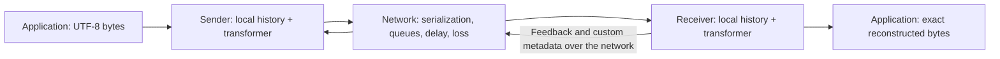

# Protocol design and roadmap

[Documentation index](README.md) · [Project overview](../README.md)

This document describes the broader research target. See the [project overview](../README.md) for current implementation status.

## The problem

Given a string, deliver its exact UTF-8 byte sequence to another endpoint while
using the network efficiently and sharing capacity with other transfers. Payloads
are opaque bytes: the model controls communication, rather than predicting or
paraphrasing the text. Empty strings, Unicode, newlines, and messages spanning many
packets are part of the task.

The underlying network delivers datagrams. It may delay, reorder, duplicate, or
drop them. Capacity, propagation delay, and competing traffic can change during a
transfer. Hosts can join, pause, disconnect, and return. The controller does not
know the true link capacity, router queues, or future network conditions.

Successful completion means exact reconstruction, never partial or approximate
text. No protocol can deliver through a permanent partition: deadlines and
explicit incomplete-transfer results are part of the interface. Temporary
disconnects can resume while endpoint state survives. Crash recovery with durable
state is a later extension.

## Existing work and why build this

The underlying ideas have substantial precedent, including transformers over
network history. This project makes no claim that learned transport or
history-based congestion control is new.

| Work | Connection to this project |
| --- | --- |
| [Remy / TCP ex Machina (2013)](https://web.mit.edu/remy/) | Automatically synthesizes endpoint congestion-control rules from network assumptions and an objective. |
| [Aurora (2019)](https://proceedings.mlr.press/v97/jay19a.html) | Studies deep RL for congestion control and provides a Gym-based test suite. |
| [MVFST-RL (2019)](https://arxiv.org/abs/1910.04054) | Integrates asynchronous RL congestion control into QUIC; highlights inference delay and continued packet transmission. [Source](https://github.com/facebookresearch/mvfst-rl) is archived. |
| [Jazz (2025 preprint)](https://arxiv.org/abs/2512.20186) | Explicitly uses a transformer over historical observations for wireless multipath congestion control. |
| [TCCO (2026 preprint)](https://arxiv.org/abs/2603.04550) | Uses transformer-based RL for temporal and cross-subflow control in multipath transport. |

Our intended focus is a compact, inspectable experiment: exact text delivery,
jointly controlled peers, customizable feedback, and a path from a CPU reference
to batched GPU packet simulation. Whether this combination produces a useful
research contribution must be established experimentally. Before implementing
training, inspect existing environments and controllers for reusable components,
license compatibility, and reproducible baselines.

## Architecture



During training, many independent networks run in parallel. A network contains
several transfers sharing physical queues. All endpoints can share policy weights,
with role and connection features distinguishing their tasks. Each endpoint uses
only its own observations and messages actually received from peers.

The simulator supplies transitions and rewards; the transformer does not create
the simulator. Training optimizes a policy through interaction. Recorded network
traces are optional inputs to simulated capacity and delay, not a prerequisite.
Deployment uses the trained policy without requiring an online training process.

## Protocol freedom and correctness

We control both ends, so the full protocol may choose its own message types,
feedback representation, ACK policy, retransmission strategy, and metadata.
It need not imitate TCP's handshake, state machine, or header format. The working
UDP adapter supplies datagrams between hosts; UDP is the outer carrier.
The current TRC1 wire format, ACKs, retransmissions, reassembly, and completion
digest are our own protocol. TCP is not in the data path, and replacing IP is
outside this project's scope.

The sender policy controls pacing and optionally the in-flight window. The
separate receiver-v1 experiment learns ACK batching and timing with the sender
held fixed. Every feedback byte consumes simulated reverse-link capacity. The
correctness kernel validates byte ranges and transmission IDs independently of
the policy. Joint endpoint learning is implemented in the separate persistent-session experiment;
GPU-native packet simulation remains unimplemented.

See [receiver experiments and device trials](receiver-experiments.md) for implementation results and deployment notes.

The first implementation uses a deliberately understandable reliability kernel:

- Connection and message identifiers, byte offsets, and a declared final length.
- Unique transmission identifiers so retransmissions have unambiguous timing.
- Explicit received byte ranges and selective feedback.
- Reassembly, duplicate suppression, integrity checks, and completion feedback.
- Bounded sender and receiver buffers, timers, and explicit transfer deadlines.

These are initial design choices, not a claim that the learned protocol must
always use this representation. Correctness remains enforced outside the neural
policy: no action can manufacture delivered bytes, acknowledge unseen data, or
overwrite the original payload. A digest can check integrity; tests compare the
actual reconstructed bytes to the source. Duplicate delivery to the application
is suppressed within a live session; durable exactly-once semantics across
crashes are outside the initial scope.

Feedback and metadata are real packets or packet fields. They consume serialized
bytes, can be delayed or lost, and have explicit size limits. Start with typed
fields, then experiment with bounded learned discrete symbols. No free side
channel is allowed. The receiver may report local buffers, arrival times, gaps,
or learned summaries; it cannot report hidden router state it never observed.
Echoed sender timestamps support RTT measurement without synchronized clocks.

## State, history, and actions

This is a partially observable multi-agent problem. The simulator's full state
includes queues, scheduled arrivals, loss processes, endpoint buffers, and traffic
generators. The policy receives a local observation history, not that full state.

### Initial observation

Each observation summarizes a 20 ms control interval. Start with 64 intervals
(1.28 seconds), normalized numeric features, elapsed times, and validity masks.

| Feature group | Available local measurements |
| --- | --- |
| Sending | Wire bytes sent, payload bytes sent, retransmitted bytes, current pacing rate |
| Delivery feedback | Newly acknowledged unique bytes, bytes declared lost, time since feedback |
| Timing | Sampled and smoothed RTT, observed minimum RTT, RTT trend; missing-sample flags |
| Buffers | Outstanding data, outstanding transmissions, unsent bytes, local receive occupancy |
| Limits | Current congestion window and peer-advertised receive credit |
| Context | Previous action, role, connection age, measurement interval |
| Custom feedback | Bounded metadata actually received, its age, and its validity |

Loss is an estimate based on observations and timers, not a simulator oracle.
RTT inflation is only a proxy for queueing delay; path changes can affect it too.
Longer histories and event-level tokens are later ablations.

### Initial action space

Start with one continuous action, `a_rate` in `[-1, 1]`:

```text
pacing_rate_next = clip(pacing_rate * exp(0.2 * a_rate), rate_min, rate_max)
```

Then add `a_window` in `[-1, 1]` with the same multiplicative update for the
congestion window. Bounds are configured independently of hidden link capacity.
Rate controls when packets leave; the window limits data outstanding. Keep
deterministic reliability and receiver feedback initially to isolate learning.

All transmissions are charged to the pacing and wire-byte budgets. New payload
must also respect receiver credit; resending already credited bytes does not
consume new receive credit. Recovery includes bounded probe and retry rules so
loss of all feedback cannot permanently deadlock the connection.

### Full action space

Add independently evaluated policy heads for:

| Decision | Examples |
| --- | --- |
| Recovery | Wait, probe, or retransmit an eligible missing range |
| Packetization | Choose payload size and batching delay |
| Feedback | Send now or delay; select ranges and summary fields |
| Metadata | Emit a bounded custom message or learned discrete symbols |
| Scheduling | Select a connection or queued message to serve |
| Redundancy | Choose bounded duplication or a separately specified coding scheme |
| Multipath | Select among genuinely available paths and allocate traffic |

Use action masks and bounded parameterizations. Protocol code implements each
operation. More actions are introduced only after establishing a baseline; a
large unstructured packet-generation action space is not the starting point.

### Model and training

Start with a causal transformer with two layers, width 64, four attention heads,
and separate actor and value heads. These are hypotheses to benchmark. The
transformer consumes network telemetry, not text tokens. History and positional
information reset on new sessions; resumed sessions preserve their defined state.

Use PPO as the initial training method. Compare against an MLP with stacked
observations and a recurrent controller at comparable parameter and compute
budgets. A transformer is useful only if history improves behavior enough to
justify its inference cost. Inference must fit the control interval; later
real-time operation continues sending under the previous action during inference.

For the full self-play setting, train both peers cooperatively with shared
weights and explicit roles. Multiple connections compete for capacity, but the
training objective should discourage starvation across the network. A centralized
training critic may use additional state only when explicitly documented; the
deployed actor remains local.

## The simple test environment

The implemented first milestone is a deterministic, seeded CPU packet simulator with:

1. One sender, one receiver, one finite FIFO bottleneck, and an explicit feedback path.
2. Serialization delay from packet size and bitrate, including headers and metadata.
3. Configurable propagation delay, jitter, random loss, and queue-overflow loss.
4. Packet reordering and duplication scenarios; data and feedback impairment tests.
5. Fixed-rate and AIMD controllers using identical reliability code.
6. An end-to-end arbitrary-text transfer test that checks exact UTF-8 bytes.

Initial scenario ranges can be 0.5--20 Mbit/s, 10--200 ms base RTT, 0--5% random
packet loss, and 8--128 KiB bottleneck queues. These are proposed experiment
settings, not measured deployment limits. Add burst loss, capacity changes,
asymmetric feedback paths, disconnects, and 2--8 competing senders as named cases.

Control intervals and network timing are separate. A policy acts every 20 ms;
the simulator must preserve finer serialization and arrival timing. Use an
event-driven CPU reference, and validate any fixed-tick GPU approximation against
it. In particular, do not release an interval's entire traffic as one burst.

A short string tests correctness but rarely exercises congestion. Training uses
larger messages or repeated messages over several seconds; evaluation includes
short transfers, long transfers, cold starts, empty messages, and Unicode strings.
Finite simulation buffers impose explicit configured limits; large application
messages must be chunked with backpressure rather than silently truncated.

### Application interface

The commands and Python interface above support inline text or UTF-8 files,
saved output, controller/checkpoint selection, completion, timeout, and metrics.
The same protocol state machine and policy interface back the simulator and UDP
listener/sender. The reference supports one complete message per UDP listener;
session multiplexing and streaming are later work. Multi-host support
means concurrent endpoint sessions, not learning IP routing. Multipath requires
explicit available paths; it cannot assume arbitrary route selection.

## Reward and evaluation

The initial per-sender reward uses unique acknowledged application bytes, an RTT
inflation estimate, and wire overhead, all normalized using fixed reference scales:

```text
reward = useful_progress / byte_scale
         - alpha * rtt_inflation / time_scale
         - beta * overhead_wire_bytes / byte_scale
```

Overhead includes headers, feedback, metadata, probes, and duplicate payload.
Receivers do not earn credit merely for asserting delivery: correctness is
verified against protocol state. In the sender-only stage, ACK semantics are fixed.
When feedback becomes learned, use independently verified receiver delivery for
training credit and evaluate end-to-end completion; this training signal is never
an actor observation. Account for feedback delay when assigning credit.

Add a verified completion bonus and an explicit unfinished-transfer penalty for
finite-message tasks. For cooperative multi-flow training, evaluate a network
objective such as sum-log goodput over active, backlogged flows, with a fixed
epsilon and explicit treatment of joins, leaves, and idle flows. Report individual
outcomes as well: a high total reward cannot excuse starvation or wrong bytes.

Measure exact completion rate, completion-time distributions, unique-byte
goodput, p50/p95 RTT, total wire bytes, retransmissions, per-flow goodput, Jain's
fairness index, and worst-flow waiting time. Separately measure inference latency,
GPU memory, environment transitions/s, packet events/s, simulated network
seconds/wall-clock second, and time to reach a defined performance target.

Use paired scenario seeds, multiple training seeds, and held-out parameter
combinations and traces. Establish fixed-rate and AIMD baselines first; later
compare with actual TCP/QUIC controllers in a common emulator. An AIMD toy is
not a complete TCP implementation. Ablate history length, transformer versus
MLP/RNN, metadata budget, sender-only versus joint training, and recovery actions.
Report inference and communication overhead rather than assuming they are free.

## Scaling to GPUs

Parallelize independent networks, with interacting senders inside each network.
Time remains causal within a network. The scalable backend keeps simulation,
observations, policy inference, rollouts, and optimization on the same device.

| Tensor | Proposed layout |
| --- | --- |
| Endpoint state | `[networks, endpoints, features]` |
| Local histories | `[networks, endpoints, history, features]` |
| Packet records | `[networks, endpoints, packet_slots, fields]` |
| Link queues | `[networks, links, queue_slots, fields]` |
| Actions | `[networks, endpoints, action_dimensions]` |

Use bounded packet slots, masks, ring buffers, and independent random streams.
Distinguish physical queue overflow from implementation storage exhaustion;
the latter must be detected and reported, not disguised as network loss.
Keep payloads immutable and track byte-range references so exact reconstruction
does not require copying strings through every GPU step.

Begin with a batched PyTorch backend and benchmark compiled tensor operations.
JAX `vmap`/`jit` is an alternative if profiling supports the switch. A vectorized
framework does not automatically accelerate Python event heaps. Fixed-tick or
bounded event processing needs explicit timing-error and overflow checks.

Benchmark 128, 512, and 2,048 networks with four senders as scaling experiments,
not capacity promises. History storage, outstanding packets, and transformer
training activations determine memory requirements. Store each rollout observation
once and construct training history windows as needed, including the context
preceding rollout boundaries. Invalidate history on resets. Multi-GPU training
can shard independent networks and synchronize policy gradients after single-GPU
correctness and throughput are established.

## Roadmap and definition of the full version

| Stage | Deliverable | Acceptance condition |
| --- | --- | --- |
| 0: specification | README, related work, paper draft | Scope, observability, correctness, and baselines are explicit. |
| 1: reliable text | CPU simulator, reliability kernel, fixed-rate/AIMD demo | Exact bytes under scripted loss, duplication, reordering, and lost completion feedback; explicit failure on deadline. |
| 2: learned sender | History transformer, PPO, reproducible evaluation | Held-out comparison with fixed-rate, AIMD, MLP, and recurrent policies. |
| 3: GPU backend | Batched packet simulation and training | Agreement with reference on deterministic cases; quantified approximation error and measured throughput. |
| 4: joint protocol | Learned receiver feedback, metadata, recovery, scheduling | Correctness preserved; wire costs charged; ablations justify each additional action. |
| 5: usable transport | UDP sender/listener, files and inline text, resumable sessions | Exact text between separate hosts under controlled impairment and real inference timing. |
| 6: full experiment | Many hosts, changing workloads, optional multipath/redundancy | Reproducible generalization, fairness, failure, and scale results against suitable transport baselines. |

The full version is a usable custom endpoint protocol with transformer policies
at both ends, local histories, learned communication and transport decisions,
bounded resource use, exact payload delivery, a GPU training environment, and a
real datagram adapter. It does not require a new IP layer or interoperability with
unmodified TCP peers. Protocol compatibility between our own endpoints remains
explicit and versioned as packet schemas or learned metadata change.
